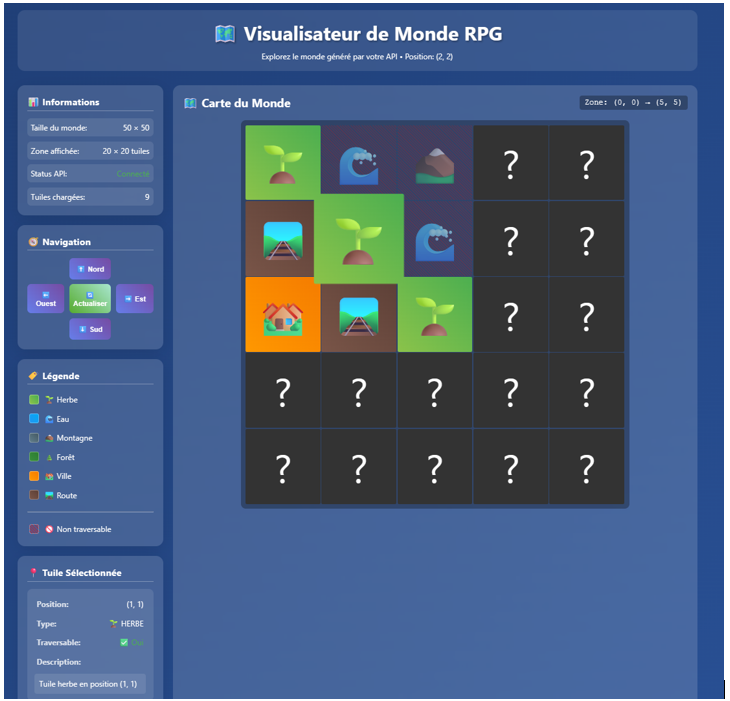
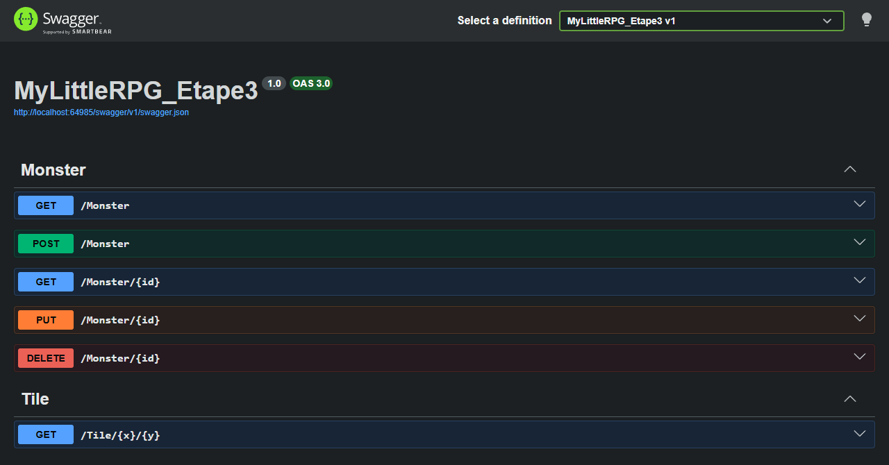

# My Little RPG

API ASP.NET Core qui génère, du côté de l'API, les tuiles d'une carte d'un jeu de type "RPG" qui sont découvertes au fur et à mesure qu'on bouge sur la carte. Des monstres (basés sur l'API gratuite PokéAPI) apparaissent sur la carte.

**Technologies :** C#, ASP.NET Core 8, Entity Framework Core 8 (migrations), MySQL (Pomelo), Swagger, HTML, CSS, jQuery, Bootstrap

## Ce que fait l'API

- `GET /Tile/{x}/{y}` retourne la tuile à cette position. Si elle n'existe pas en base, le terrain est tiré au hasard selon des poids : route 35 %, herbe 20 %, forêt 15 %, montagne 15 %, eau 10 %, ville 5 %. L'eau et la montagne ne sont pas traversables.
- `GET`, `POST`, `PUT` et `DELETE` sur `/Monster` pour gérer les monstres.
- Les images des tuiles sont servies par l'API (`/images/...`).




## Lancer le projet

1. Créer la base locale `mylittlerpg` avec `Database/mylittlerpg.sql` (voir [Base de données locale](../README.md#base-de-données-locale)).
2. Ouvrir `ApiMobileE3_VsSol/MyLittleRPG.slnx` dans Visual Studio 2022 et lancer le profil **MyLittleRPG_Etape3**. Swagger s'ouvre sur `https://localhost:64984/swagger`.
   Au premier lancement, accepter le certificat HTTPS de développement proposé par Visual Studio.
3. Avec l'API en marche, ouvrir `ApiMobileE3_Web/index.html` dans un navigateur et cliquer sur une tuile pour voir son détail.

Sans Visual Studio, avec le SDK .NET 8 :

```
dotnet dev-certs https --trust
dotnet run --project ApiMobileE3_VsSol/MyLittleRPG_Etape3 --launch-profile MyLittleRPG_Etape3
```

## Organisation

```
ApiMobileE3_VsSol/MyLittleRPG_Etape3/
  Controllers/        Tile, Monster
  Data/Context/       contexte EF Core
  Migrations/         historique du schéma
  Models/             Tile, Monster, types de terrain
  wwwroot/images/     images des tuiles
ApiMobileE3_Web/      page Web (index.html, app.js, style.css)
Database/             script de la base de démonstration
```
