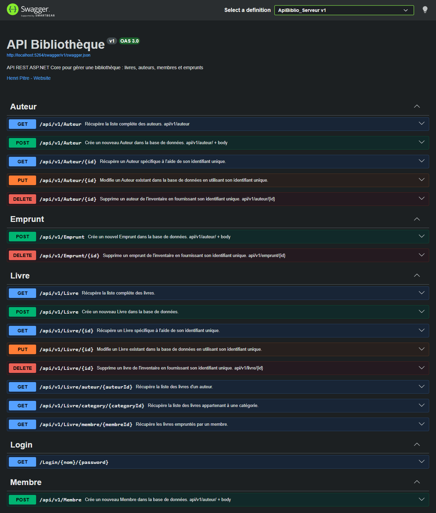

# API Bibliothèque

API REST de gestion d'une bibliothèque, sécurisée par clé d'API, avec autorisations par rôle et nombre de requêtes limité. La documentation Swagger est générée à partir des commentaires XML du code.



**Technologies :** C#, ASP.NET Core 8, ADO.NET (MySql.Data), MySQL, Swagger

## Compte de test

| Utilisateur | Mot de passe | Clé d'API | Rôle |
|---|---|---|---|
| `admin` | `admin` | `admin_apikey` | admin |
| `editor` | `editor` | `editor_apikey` | éditeur |
| `user` | `user` | `user_apikey` | utilisateur |

Les routes protégées demandent l'en-tête `x-api-key`, par exemple `x-api-key: admin_apikey`. Chaque clé a droit à 20 requêtes protégées par période de 24 h.

## Lancer l'API

1. Créer la base locale `api_bibliotheque` avec `Database/api_bibliotheque.sql` (voir [Base de données locale](../README.md#base-de-données-locale)).
2. Ouvrir `Code/ApiBiblio.sln` dans Visual Studio 2022 et lancer le profil **https**. Swagger s'ouvre sur `https://localhost:7076/swagger`.
3. Tester les routes de l'une de ces façons :
   - **Visual Studio :** ouvrir `Code/Som5_Serveur/ApiBiblio_Serveur.http` et cliquer sur *Send request* au-dessus de chaque requête (connexion, lecture, ajout avec et sans clé).
   - **Postman :** lancer plutôt le profil **http** (`http://localhost:5264`) et ajouter l'en-tête `x-api-key` aux requêtes protégées.
   - **Swagger :** pratique pour les routes publiques. Il n'a pas de champ pour la clé d'API.

Sans Visual Studio, avec le [ASP.NET Core Runtime 8](https://dotnet.microsoft.com/download/dotnet/8.0) :

```
cd Release
ApiBiblio_Serveur.exe --environment Development --urls http://localhost:5264
```

Puis ouvrir `http://localhost:5264/swagger`.

## Routes principales

| Méthode | Route | Accès |
|---|---|---|
| GET | `/Login/{utilisateur}/{motDePasse}` | public, retourne la clé d'API |
| GET | `/api/v1/Livre`, `/api/v1/Livre/{id}` | public |
| GET | `/api/v1/Livre/auteur/{id}`, `/category/{id}`, `/membre/{id}` | public |
| POST | `/api/v1/Livre` | admin |
| PUT | `/api/v1/Livre/{id}` | admin, éditeur |
| DELETE | `/api/v1/Livre/{id}` | admin |
| GET | `/api/v1/Auteur`, `/api/v1/Auteur/{id}` | public |
| POST | `/api/v1/Auteur` | admin |
| PUT | `/api/v1/Auteur/{id}` | admin, éditeur |
| DELETE | `/api/v1/Auteur/{id}` | admin |
| GET, DELETE | `/api/v1/Emprunt/{id}` | admin |
| POST | `/api/v1/Emprunt` | admin |
| POST | `/api/v1/Membre` | admin |

## Points techniques

- Couche d'accès aux données (DAL) avec une *factory* par table et des requêtes SQL paramétrées.
- Filtres personnalisés : `[Authentication]` vérifie la clé d'API, `[CustomAuthorize(...)]` vérifie le rôle, `[AllowAnonymous]` ouvre les routes publiques.
- Quota : chaque clé a un nombre maximal de requêtes par période de 24 h (table `projet_quota_api`). Une fois la limite atteinte, l'API répond 429 avec l'heure de réinitialisation.
- Codes de réponse HTTP explicites : 200, 201, 204, 400, 404, 500, et pour la sécurité 401 (clé absente), 403 (rôle insuffisant) et 429 (quota atteint).

## Organisation

```
Code/Som5_Serveur/
  Controllers/        Livre, Auteur, Membre, Emprunt, Login
  DataAccessLayer/    DAL et factories (une par table)
  Models/             classes du domaine
  Security/           authentification, rôles, quota
Database/             script de la base de démonstration
Release/              version compilée
```
