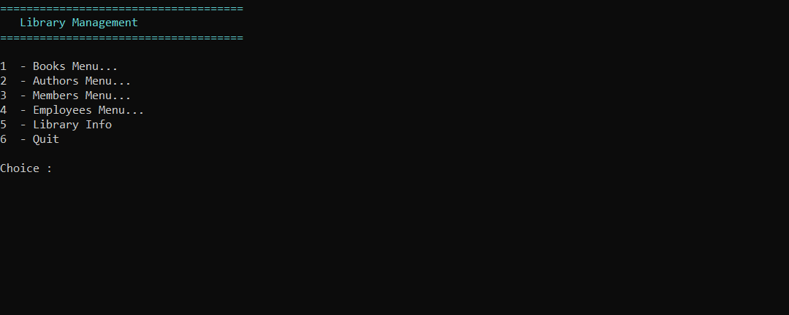

# Portfolio de Henri Pitre

Étudiant en 3<sup>e</sup> année du DEC-BAC en Techniques de l'informatique (conception et développement d'applications) au Cégep de Chicoutimi.
Je cherche un **stage ATE de mi-mars à mi-mai 2027** ou un **emploi à temps partiel dès janvier 2027**.

Pour vous démontrer mes compétences, voici donc ce github ! Vous trouverez toutes les informations ci-bas et/ou dans chaque projet individuel.

henripitre.dev@gmail.com 

## Projets

| Projet | Type | Technologies |
|---|---|---|
| [My Little RPG](API-AspNet-EfCore_HPitre) | API REST et page Web | ASP.NET Core 8, EF Core, MySQL, jQuery |
| [API Bibliothèque](API-REST_HPitre) | API REST sécurisée | ASP.NET Core 8, ADO.NET, MySQL, Swagger |
| [Unleashed Go](WPF_GoGame_HPitre) | Jeu de bureau | C#, WPF, MVVM, MSTest |
| [SplitBill](WPF_SplitBill_HPitre) | Application de bureau, en équipe | C#, WPF, MVVM, xUnit, Moq |
| [VinylVault](WEB_DJANGO_HPitre) | Site Web | Python, Django, SQLite, Bootstrap |
| [Bibliothèque](CMD_Bibliotheque_HPitre) | Application console, en équipe | C#, .NET 8, MSTest |

Il est à noter que malgré que ce soit un bon résumé, les projets démontrés ci-dessous sont sommaires et ne montrent pas absolument toutes mes compétences. Par exemple, j'ai appris à utiliser Docker, InnoSetup, Mermaid/PUML/SoftwareIdeasModeler, AJAX et une tonne d'autres produits, mais je n'ai pas pu tout inclure ici car il m'était important à mes yeux de limiter votre temps passé à comprendre ce que je sais faire.

Chaque dossier contient le code source et un README avec les étapes pour lancer le projet. Selon le projet, on y trouve aussi une version compilée (`Release`) et les documents de conception (cahier des charges, conception, guide utilisateur, bilan) qui ont tous été réalisés par mes soins, m'ayant permis de développer mon sens de l'analyse et de la gestion de projets.

### [My Little RPG](API-AspNet-EfCore_HPitre)
API qui génère les tuiles d'une carte de jeu de rôle (type de terrain tiré au hasard selon des probabilités, cases traversables ou non) et qui gère une liste de monstres. Une page Web affiche la carte et le détail de chaque tuile.

Pour l'essayer : base MySQL locale, puis Visual Studio. [Étapes](API-AspNet-EfCore_HPitre/README.md)

### [API Bibliothèque](API-REST_HPitre)
API REST de gestion d'une bibliothèque : livres, auteurs, membres et emprunts. Authentification par clé d'API, autorisations par rôle et nombre de requêtes limité par période de 24 h.

Compte de test : `admin` / `admin`, clé d'API `admin_apikey`. Base MySQL locale requise. [Étapes](API-REST_HPitre/README.md)

### [Unleashed Go](WPF_GoGame_HPitre)
Jeu de Go pour deux joueurs sur plateau 9×9 : komi, handicaps, captures, règle du ko, coups suicide refusés, calcul du territoire et chronomètre pour chaque joueur.

**Les plateaux 13x13 et 19x19 ne sont pas fonctionnels, car ils n'étaient pas à implémenter lors du développement du projet.**


Prêt à lancer : `Release/GoGame.exe`. [Détails](WPF_GoGame_HPitre/README.md)

### [SplitBill](WPF_SplitBill_HPitre)
Application pour partager les dépenses d'un groupe : activités, dépenses réparties entre participants, remboursements et solde de chacun. Comptes protégés par mot de passe.


(Réalisé avec Tommy-Frédéric Bernaquez). Compte de test : `Alice` / `alice123`. [Détails](WPF_SplitBill_HPitre/README.md)

### [VinylVault](WEB_DJANGO_HPitre)
Site Web pour gérer une collection de vinyles : artistes, albums et chansons, avec la collection personnelle de chaque membre (possédé ou souhaité, note, coup de cœur). Permissions par groupe et interface en français et en anglais.


Compte de test : `gestionnaire` / `demo1234`. [Étapes](WEB_DJANGO_HPitre/README.md)

### [Bibliothèque](CMD_Bibliotheque_HPitre)
Application console pour gérer une bibliothèque : livres, auteurs, membres et employés, recherche, prêts et retours. Les données sont enregistrées dans des fichiers CSV.



Réalisé avec Tommy-Frédéric Bernaquez. Prêt à lancer : `Release/Bibliotheque.exe`. [Détails](CMD_Bibliotheque_HPitre/README.md)

## Configuration requise

- Windows 10 ou 11
- [.NET 8](https://dotnet.microsoft.com/download/dotnet/8.0) : le SDK pour ouvrir le code, ou seulement le *Desktop Runtime* pour lancer les `.exe`
- Visual Studio 2022 à jour
- MySQL 8 ou Docker, pour les deux API (voir ci-dessous)
- Python 3.12 ou plus récent, pour VinylVault

## Base de données locale

Les deux API se connectent à MySQL sur `localhost:3306`, avec l'utilisateur `root` et le mot de passe `portfolio`.

**Avec Docker**, une seule commande :

```
docker run --name mysql-portfolio -e MYSQL_ROOT_PASSWORD=portfolio -p 3306:3306 -d mysql:8.0
```

**Avec MySQL déjà installé**, remplacer `portfolio` par votre mot de passe `root` dans le fichier `appsettings.json` de chaque API.

Ensuite, dans MySQL Workbench, ouvrir chaque script avec *File > Run SQL Script* et cliquer sur *Run*. Chaque script crée sa propre base :

| Script | Base créée |
|---|---|
| `API-REST_HPitre/Database/api_bibliotheque.sql` | `api_bibliotheque` |
| `API-AspNet-EfCore_HPitre/Database/mylittlerpg.sql` | `mylittlerpg` |

---

Projets réalisés dans le cadre de mes études au Cégep de Chicoutimi.
Faute de temps et de souci de ponçage, aucun projet personnel n'est inclus,
Mais plusieurs sont en cours actuellement !
