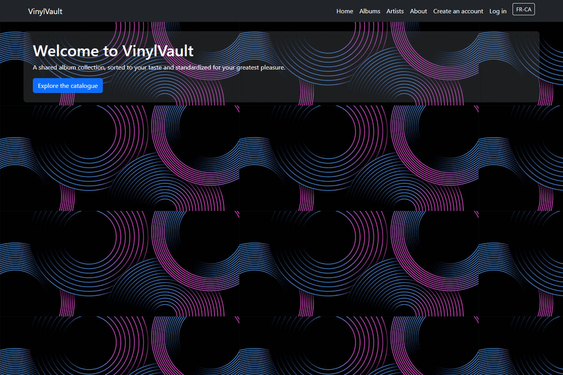
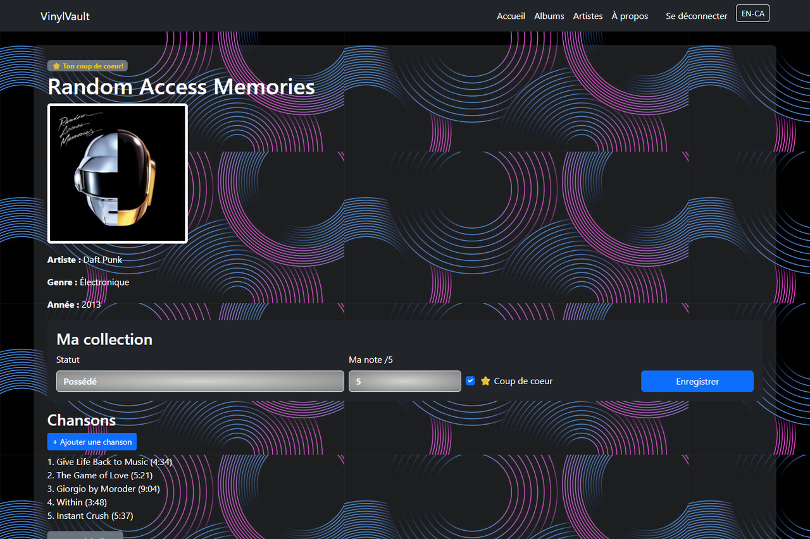
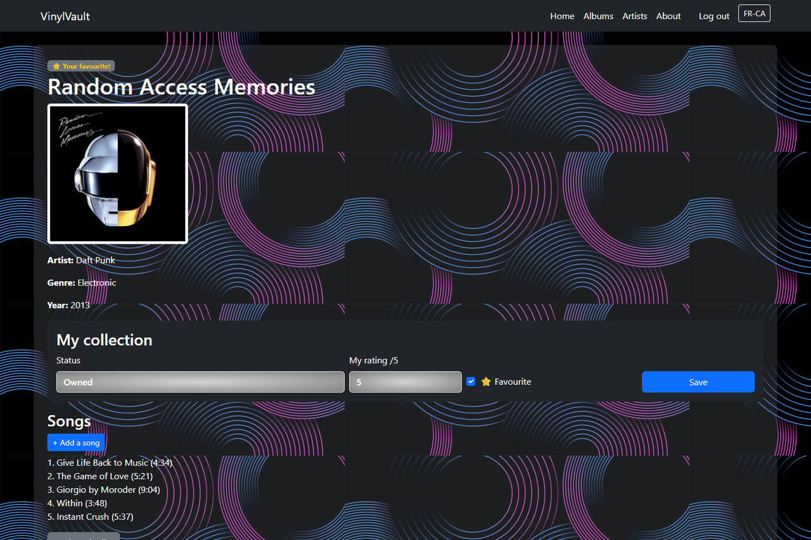

# VinylVault

Site Web Django pour gérer une collection de vinyles. Chaque membre tient sa propre collection, et l'ajout ou la modification du catalogue dépend du groupe de l'utilisateur.



**Technologies :** Python, Django 6, django-modeltranslation, SQLite, Bootstrap 5, HTML, CSS, JavaScript

## Fonctionnalités

- Catalogue d'artistes, d'albums (avec pochette) et de chansons, avec pagination
- Création de compte, connexion, modification du profil et du mot de passe
- Collection personnelle : chaque membre indique si un album est possédé ou souhaité, lui donne une note et peut en faire un coup de cœur
- Permissions par groupe : les *Gestionnaires* peuvent tout faire, les *Collectionneurs* peuvent ajouter et modifier
- Interface et contenu en français et en anglais

| Ma collection | Version anglaise |
|---|---|
|  |  |

Les pochettes sont chargées depuis [Cover Art Archive](https://coverartarchive.org), donc une connexion Internet est nécessaire pour les afficher.

## Lancer le site

Avec Python 3.12 ou plus récent, dans PowerShell :

```
cd WEB_DJANGO_HPitre\Code
python -m venv .venv
.venv\Scripts\Activate.ps1
pip install -r requirements.txt
python manage.py migrate
python manage.py seed_demo
python manage.py runserver
```

Puis ouvrir `http://127.0.0.1:8000`.

La commande `seed_demo` charge les données de démonstration (44 artistes, 50 albums, 249 chansons) et crée les comptes de test.

## Comptes de test

| Utilisateur | Mot de passe | Accès |
|---|---|---|
| `gestionnaire` | `demo1234` | ajouter, modifier et supprimer |
| `collectionneur` | `demo1234` | ajouter et modifier |
| `admin` | `admin` | administration Django (`/admin`) |

## Organisation

```
Code/
  config/        paramètres et URL du projet
  vinylvault/    catalogue et collection (modèles, vues, gabarits, données de démonstration)
  member_app/    comptes : inscription, connexion, profil
  locale/        traduction anglaise
```
