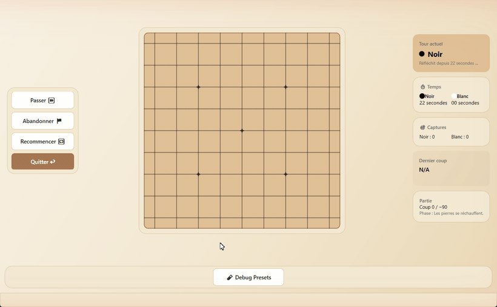
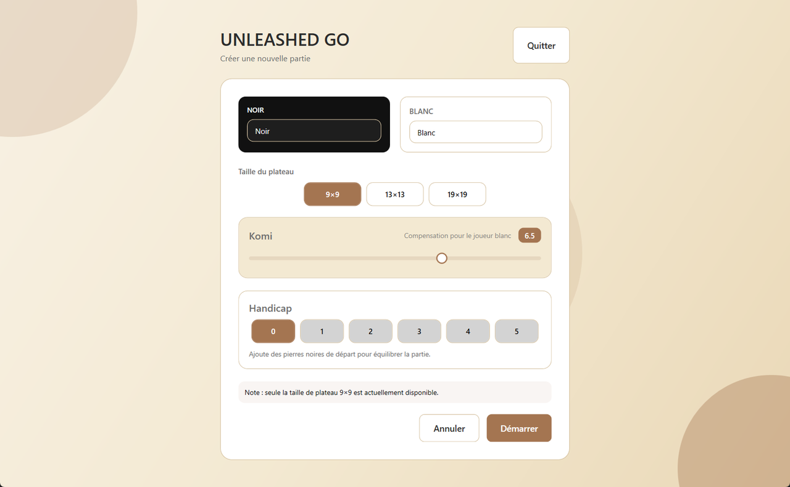
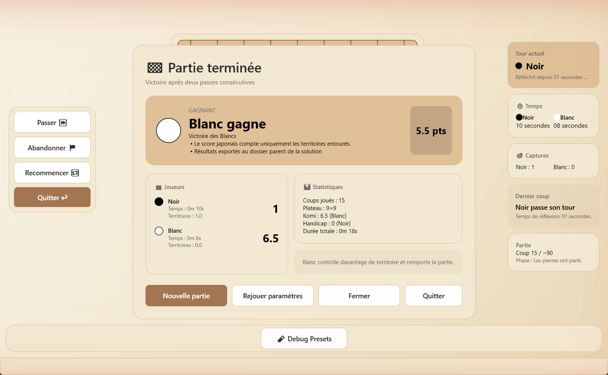

# Unleashed Go

Jeu de Go pour deux joueurs sur le même ordinateur, développé en C# avec WPF selon le patron MVVM. Projet individuel mené du cahier des charges jusqu'au bilan.

**Technologies :** C#, .NET 8, WPF, MVVM, MSTest

## Fonctionnalités

- Plateau 9×9, komi réglable et jusqu'à 5 pierres de handicap (le modèle prévoit aussi le 13×13 et le 19×19, pas encore offerts dans l'interface)
- Captures de groupes (parcours en largeur des libertés), règle du ko, coups suicide refusés
- Fin de partie par deux passes consécutives ou abandon, puis calcul du territoire avec komi
- Chronomètre pour chaque joueur et durée totale de la partie
- Export des résultats de chaque partie en XML (`UNLEASHEDGO_Results.xml`, à côté de l'exécutable)

| Nouvelle partie | Fin de partie |
|---|---|
|  |  |

## Lancer le jeu

- **Version prête :** `Release/GoGame.exe` (Windows, avec le [.NET 8 Desktop Runtime](https://dotnet.microsoft.com/download/dotnet/8.0)).
- **Code :** ouvrir `Code/UnleashedGo.sln` dans Visual Studio 2022. Les 18 tests unitaires se lancent avec *Test > Exécuter tous les tests*.

## Documents

- [Cahier des charges](Conception/Livrable1-Cahier-des-charges.pdf)
- [Cahier de conception](Conception/Livrable2-Cahier-de-conception.pdf)
- [Guide utilisateur](Conception/Livrable4-Guide-utilisateur.pdf)
- [Bilan du projet](Conception/Livrable5-Bilan.pdf)
