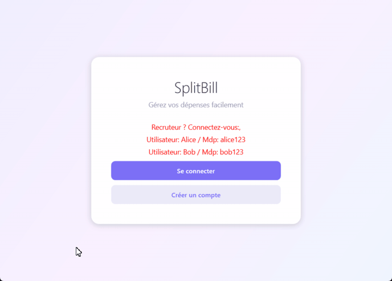
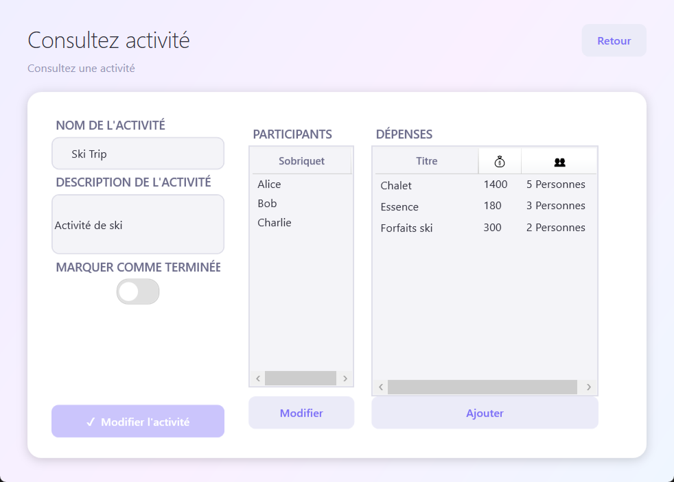
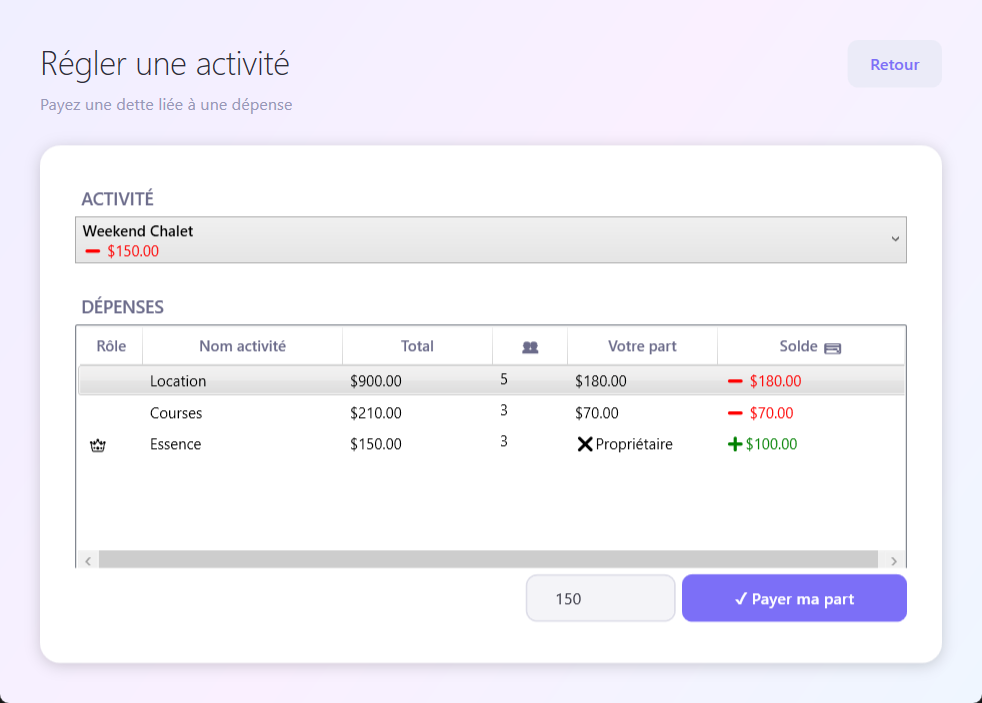

# SplitBill

Application de bureau pour partager les dépenses d'un groupe (voyage, colocation, souper) et savoir qui doit combien à qui. Projet d'équipe réalisé avec Tommy-Frédéric Bernaquez.

**Technologies :** C#, .NET 8, WPF, MVVM, persistance XML, xUnit, Moq

## Fonctionnalités

- Création de compte et connexion, mots de passe enregistrés sous forme hachée
- Activités avec leurs participants
- Dépenses réparties entre les participants choisis
- Remboursements et solde de chaque participant
- Données sauvegardées dans un fichier XML

| Détail d'une activité | Règlement d'une dette |
|---|---|
|  |  |

## Comptes de test

| Utilisateur | Mot de passe |
|---|---|
| `Alice` | `alice123` |
| `Bob` | `bob123` |
| `Charlie` | `charlie123` |
| `Diana` | `diana123` |

L'activité « Ski Trip » est déjà remplie avec des dépenses pour voir les soldes.

## Lancer l'application

- **Version prête :** `Release/splitbill.exe` (Windows, avec le [.NET 8 Desktop Runtime](https://dotnet.microsoft.com/download/dotnet/8.0)). Les données de démonstration sont dans `Release/Data/data.xml`.
- **Code :** ouvrir `Code/splitbill.sln` dans Visual Studio 2022. Les 78 tests unitaires se lancent avec *Test > Exécuter tous les tests*.

## Documents

- [Cahier des charges](Conception/Livrables/Livrable1-Cahier-des-charges.pdf)
- [Cahier de conception](Conception/Livrables/Livrable2-Cahier-de-conception.pdf)
- [Guide utilisateur](Conception/Livrables/Livrable4-Guide-utilisateur.pdf)
- [Bilan du projet](Conception/Livrables/Livrable5-Bilan.pdf)
